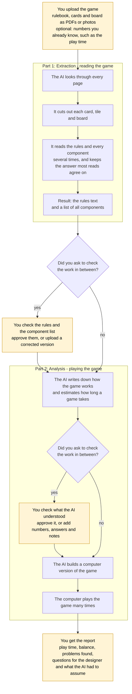

# How It Works

What happens to a board game from the moment you upload it until you get the results. The technical version is in [Pipeline Flow](./pipeline-flow.md).

The yellow boxes are the moments where a person takes part. All other steps run on their own.

- **Checking in between is optional.** When you start, you choose if the run stops for you. If you do not choose this, the run goes from upload to report without a stop.
- **You can stop a run at any time.**
- **A finished run can be played back**, so you can see what the AI did step by step.
