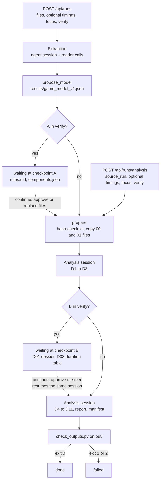
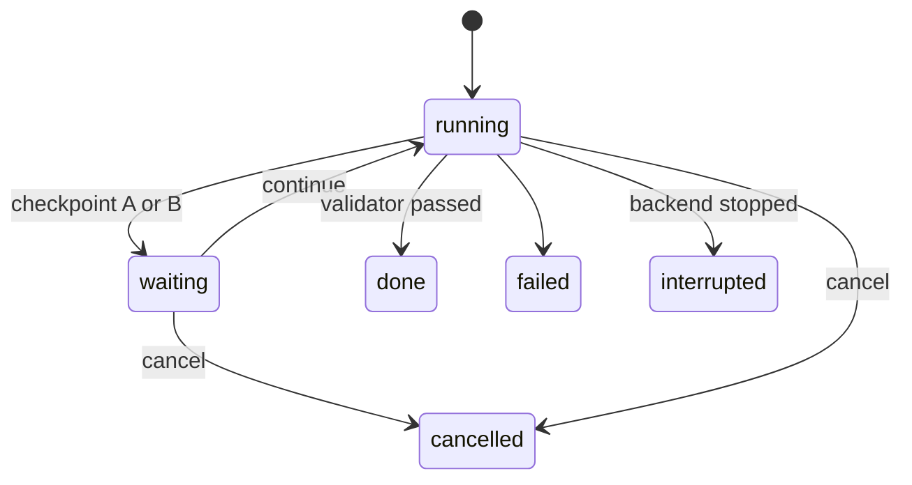
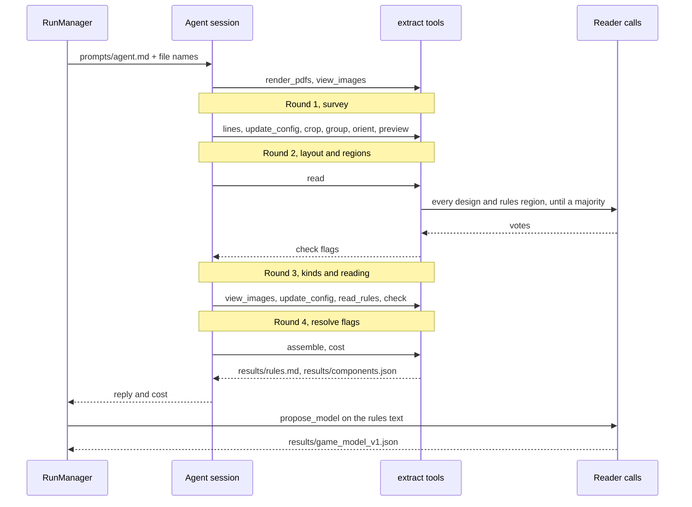
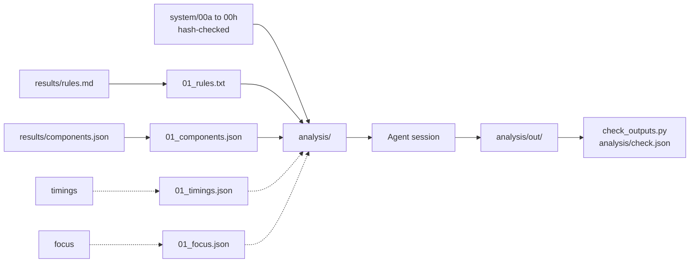

# Pipeline Flow

How one run goes through the backend, from upload to results. Code: `backend/app/extraction/` and `backend/app/analysis/`.

## One run



Any step can end in `failed`. `POST /api/runs/{id}/cancel` ends a running or waiting run as `cancelled`. A run that was `running` when the backend stopped becomes `interrupted`.

## Run states



A waiting run frees the one-run slot and survives a restart. `continue` returns 409 when the run is not waiting or another run is busy.

## Extraction

The agent makes the judgments and works only through the `extract` tools. Reader calls do the bulk reading: each is a tool-less model call that sees one item or one region.

- System prompt: `backend/app/extraction/prompts/agent.md`
- User prompt: `Extract the uploaded files: <names>`
- Models: `INNERGAMES_AGENT_MODEL` and `INNERGAMES_READER_MODEL`, both `haiku` by default



| Tool | What it does |
| --- | --- |
| `render_pdfs` | Renders page images, previews and the text layer |
| `lines` | Prints the cut lines of a grid page |
| `update_config` | Changes the extraction config |
| `view_images` | Opens images for the agent |
| `crop` | Cuts out every item |
| `group` | Groups identical fronts into designs and matches backs |
| `orient` | Finds which way each design's text runs |
| `preview` | Draws the rules regions |
| `read` | Reads all designs and rules regions, then runs `check` |
| `read_rules` | Reads changed rules regions again |
| `check` | Prints every consistency flag |
| `assemble` | Writes and validates the results |
| `cost` | Prints the reader cost so far |

## Analysis

One Claude Agent SDK session runs the kit in `analysis-pipeline/`. It writes its own engine, simulates the game and writes the output files.

- Prompt: `Read 00a_START_HERE.md and follow it.`
- System prompt: the Claude Code preset plus `ENVIRONMENT` in `backend/app/analysis/session.py`. With B in `verify`, `CHECKPOINT_NOTE` is added.
- Model: `INNERGAMES_ANALYSIS_MODEL`, `claude-opus-5-5` by default, effort high
- Tools: `Bash`, `Read`, `Write`, `Edit`. No user settings, skills or MCP servers.



`game_model_v1.json` and the original uploads do not go to the analysis. The target play time and player counts are fixed in `00a`.

| Deliverable | Output | Written |
| --- | --- | --- |
| D1 rules dossier | `D01_rules_dossier.md`, `D01_board_layout.json` | Before B |
| D2 rules engine | `D02_engine_v<n>.py`, `D02_run.py` | Before B, later versions after |
| D3 playtime model | `D03_playtime_model.md`, `D03_duration_table.json` | Before B |
| D4 to D8 simulations | `D04` to `D08`, per-game and event zips | After B |
| D9 limitations | `D09_limitations.md` | After B |
| D10 designer questions | `D10_designer_questions.md` | After B |
| D11 data needed | `D11_data_needed.md` | After B |
| Summary | `REPORT.md`, `headline.json`, `summary.json`, `run_manifest.json` | After B |

## Checkpoints

| Checkpoint | The person sees | `continue` body |
| --- | --- | --- |
| A, after extraction | `results/rules.md`, `results/components.json` | Empty, or multipart with `rules` and/or `components` |
| B, before the simulation | `analysis/out/D01_rules_dossier.md`, `analysis/out/D03_duration_table.json` | Empty, or JSON with `timings`, `focus`, `answers`, `note` |

At B, new `timings` merge into `01_timings.json` and new `focus` replaces `01_focus.json`. The steering goes to the session as its next message.

## API

| Call | What it does |
| --- | --- |
| `POST /api/runs` | Starts extraction and analysis |
| `POST /api/runs/analysis` | Starts the analysis on an earlier run's results |
| `GET /api/runs` | Lists runs |
| `GET /api/runs/{id}` | Returns the status |
| `GET /api/runs/{id}/events?after=n` | Returns the events after index `n` |
| `GET /api/runs/{id}/files/{path}` | Returns a file from the run folder |
| `POST /api/runs/{id}/continue` | Approves or steers a waiting run |
| `POST /api/runs/{id}/cancel` | Cancels a running or waiting run |
| `GET /api/runs/{id}/replay?elapsed_s=n` | Returns a finished run as it was `n` seconds after its start |

For a results screen, read `analysis/out/headline.json` through the files call.

## Replay

A finished run is its own recording: `run.json`, `events.jsonl` and the output files. The client keeps the clock and asks for frames at any speed. Replay calls no model and runs nothing again.

## Run folder

```text
<data dir>/runs/<id>/
  run.json               status
  events.jsonl           events of the whole run
  analysis_request.json  timings and focus from the start
  input/                 uploaded files
  work/                  extraction working files
  results/               rules.md, components.json, game_model_v1.json
  analysis/
    00*, 01_*            session input
    events.jsonl         events of the analysis session
    out/                 analysis output
    check.json           validator result
```
